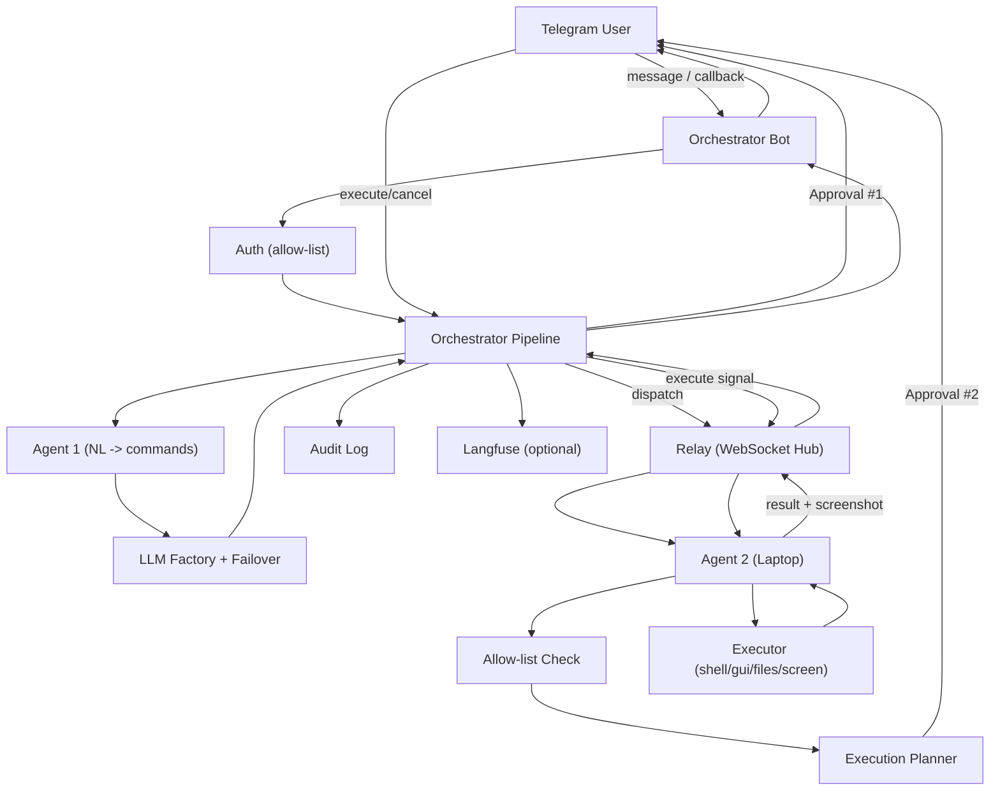

# LaptopPilot

> Remote laptop control from Telegram with natural-language commands and a double human-approval gate.

LaptopPilot lets you control your Linux laptop from your phone over Telegram. You send a plain-English request, **Agent 1** turns it into a schema-validated and risk-classified action list, you approve it, it's dispatched over a secure WebSocket relay to **Agent 2** running on your laptop, Agent 2 presents an execution plan for a second approval, and the result (with a screenshot) comes back to your chat with a full audit trail.

[](https://www.python.org/)
[](https://fastapi.dev/)
[](https://core.telegram.org/bots)
[](https://developer.mozilla.org/en-US/docs/Web/API/WebSockets_API)
[](https://langfuse.com/)
[]()

---

## Table of Contents

- [Overview](#overview)
- [Key Features](#key-features)
- [Architecture](#architecture)
- [Tech Stack](#tech-stack)
- [Project Structure](#project-structure)
- [Setup Guide](#setup-guide)
- [Usage](#usage)
- [Security & Approvals](#security--approvals)
- [LLM Provider Failover](#llm-provider-failover)
- [Observability](#observability)
- [Testing](#testing)
- [Troubleshooting](#troubleshooting)
- [Roadmap](#roadmap)
- [Author](#author)

---

## Overview

Most remote control tools are either fully manual (VNC/RDP) or fully autonomous. LaptopPilot strikes a balance: use natural language to describe what you need, but keep a human in the loop for anything that could change files, run commands, or interact with your desktop.

Every action goes through a strict pipeline: authorize sender → parse with LLM → validate against schema → classify risk → **Approval #1** → dispatch over relay → Agent 2 allow-list check → build execution plan → **Approval #2** → execute on laptop → return result + screenshot to Telegram with full audit logging.

---

## Key Features

- **Natural language control** – Say things like *"open VS Code in my backend project"* and let Agent 1 translate to safe, structured commands.
- **Double human-in-the-loop** – Approval #1 after command generation, Approval #2 after Agent 2 builds an execution plan.
- **Risk-based flow** – Low-risk actions can be auto-proceeded if enabled. Medium/high-risk actions always require both approvals.
- **Outbound-only relay** – Agent 2 dials out to the relay over WSS. No need to open inbound ports on your laptop.
- **Allow-list enforcement** – Agent 2 runs an independent allow-list check for actions, paths, applications and commands before building a plan.
- **Persistent shell** – Agent 2 keeps a persistent bash session so `cd` and environment changes persist across commands.
- **Real desktop control** – Open/close apps, run shell commands, read/write/delete files, and capture screenshots via `pyautogui`, `wmctrl`, `scrot`/`PIL`.
- **Multi-provider LLM with failover** – Supports Gemini, Groq, NVIDIA NIM, and Omniroute with automatic fallback on failure.
- **Full audit trail** – Every request, approval, dispatch, execution and error is logged to `logs/audit.log`.
- **Langfuse tracing** – Optional end-to-end tracing of requests, LLM calls and provider switches.
- **Session awareness** – Orchestrator tracks cwd, conversation history and last known laptop state per user.

---

## Architecture



### Flow summary

1. **Request** – User sends a message to the Telegram bot.
2. **Parse & classify** – Orchestrator authorizes the sender, Agent 1 converts NL to schema-valid commands and the risk classifier assigns `low`/`medium`/`high`.
3. **Approval #1** – For non-auto-proceeded requests, the bot sends an inline keyboard for approve/disapprove.
4. **Dispatch** – On approval (or low-risk auto-proceed), commands are dispatched to Agent 2 via the relay.
5. **Plan & Approval #2** – Agent 2 checks allow-list, builds a step-by-step plan and requests a second approval from the user.
6. **Execute** – On execute, Agent 2 runs the commands with its persistent shell and desktop tools, captures results/screenshots.
7. **Report** – Results are routed back through the relay to the orchestrator, logged to audit, traced to Langfuse (if enabled), and sent to Telegram.

---

## Tech Stack

| Layer | Technologies |
|---|---|
| **API/Services** | `FastAPI`, `Uvicorn`, `WebSockets` |
| **Bot** | `python-telegram-bot` (webhook mode) |
| **Validation/Config** | `Pydantic`, `pydantic-settings`, `python-dotenv` |
| **LLM Providers** | `google-genai` (Gemini), `groq`, `openai` (NVIDIA NIM / Omniroute) |
| **Desktop Automation** | `pyautogui`, `pexpect`, `Pillow` |
| **Observability** | `langfuse` |
| **Testing** | `pytest`, `httpx`, `uvicorn` |

See [`requirements.txt`](requirements.txt) for pinned dependencies.

---

## Project Structure

```text
LaptopPilot/
├── agent1/                # Agent 1: NL -> validated, risk-classified commands
├── agent2/                # Agent 2: allow-list, planner, executor (runs on laptop)
│   └── executor/          # terminal, gui, files, processes, screen
├── orchestrator/          # Orchestrator: auth, sessions, approvals, audit, bot, pipeline
│   ├── bot/               # Telegram handlers, messages, webhook wiring
│   └── runner.py          # Production entrypoint: polling + relay + real Agent 1
├── relay/                 # WebSocket relay bridge (orchestrator <-> agent2)
├── shared/                # Cross-cutting: schema, risk classifier, LLM factory/failover, tracing, messages, net
│   ├── llm/               # Provider adapters, factory, FallbackRouter
│   └── tracing/           # Langfuse client/helpers
├── config/                # Local allow-list config (e.g. allowlist.json)
├── logs/                  # Audit log output (gitignored)
├── .env.example           # Documented environment template
├── requirements.txt
└── architecture.md        # Detailed design notes
```

---

## Setup Guide

### Prerequisites

- Linux (Agent 2 uses `wmctrl`, `scrot`, `pexpect`, and desktop tooling)
- Python 3.11+
- A Telegram bot token from [@BotFather](https://t.me/BotFather)
- At least one LLM API key (Gemini/Groq/NVIDIA) or an Omniroute endpoint
- Publicly reachable URL for the relay/orchestrator if using webhook over internet (or use Tailscale/ngrok for testing)

### 1) Clone and enter

```bash
git clone https://github.com/Skalith/laptop-pilot.git
cd laptop-pilot
```

### 2) Create virtual environment

```bash
python3 -m venv .venv
source .venv/bin/activate
pip install --upgrade pip
pip install -r requirements.txt
```

### 3) Configure environment

```bash
cp .env.example .env
```

Edit `.env` with your values:

| Variable | Required | Notes |
|---|---|---|
| `TELEGRAM_BOT_TOKEN` | Yes | From BotFather |
| `AUTHORIZED_USER_ID` | Yes | Comma-separated Telegram user IDs allowed to control the laptop |
| `RELAY_URL` | Yes | `ws://localhost:8765` for local, `wss://...` in production |
| `RELAY_SECRET` | Yes | Shared secret used by orchestrator and Agent 2 to auth to the relay |
| `LLM_PROVIDER_ORDER` | No | Comma-separated order, e.g. `gemini,groq`. Only list providers whose keys you set; the factory fails fast on a missing key. |
| `LLM_FALLBACK_ENABLED` | No | `true` by default; set `false` for single-provider mode |
| `GEMINI_API_KEY` / `GROQ_API_KEY` / `NVIDIA_API_KEY` / `OMNIROUTE_API_KEY` | Per provider | Add keys for providers in your order |
| `OMNIROUTE_BASE_URL` | If using Omniroute | Base URL for your Omniroute gateway |
| `LANGFUSE_PUBLIC_KEY` / `LANGFUSE_SECRET_KEY` / `LANGFUSE_HOST` | No | Leave empty to disable tracing |
| `APPROVAL_TTL_SECONDS` | No | Default `180` |
| `DISPATCH_TIMEOUT_SECONDS` | No | Default `60` (marks Agent 2 as offline if no response) |
| `AUTO_PROCEED_LOW_RISK` | No | Default `false` |
| `LOG_PATH` | No | Default `./logs/audit.log` |
| `AGENT2_ALLOWLIST_PATH` | No | Default `./config/allowlist.json` |

### 4) Configure Agent 2 allow-list

Review `config/allowlist.json`. It controls what Agent 2 is allowed to do locally. Keep this tight for safety.

```json
{
  "actions": ["CHANGE_DIRECTORY", "OPEN_APPLICATION", "RUN_COMMAND", "FILE_OPERATION", "CLOSE_APPLICATION", "TAKE_SCREENSHOT"],
  "paths": ["~/"],
  "applications": [],
  "commands": ["ls", "cd", "pwd", "cat", "echo", "mkdir", "touch"]
}
```

### 5) Run the system

Open three terminals (or use a process manager):

```bash
# Terminal 1: Relay (public bridge)
uvicorn relay.main:app --host 0.0.0.0 --port 8765
```

```bash
# Terminal 2: Agent 2 (runs on the target laptop)
python -m agent2.main
```

```bash
# Terminal 3: Orchestrator (long polling)
python -m orchestrator.runner
```

The orchestrator runs Telegram in long-polling mode and connects to the relay as the orchestrator role. If you prefer webhooks, `orchestrator/main.py` exposes `POST /telegram/webhook` for use with `uvicorn`.

---

## Usage

1. Open your Telegram bot and send a natural-language request (must be from an authorized user ID).
2. **Approval #1** – Review the parsed commands, risk level, and tap `APPROVE` or `DISAPPROVE`.
3. **Approval #2** – Agent 2 will send an execution plan. Review the steps and tap `EXECUTE` or `CANCEL`.
4. Get results back in chat, including command outputs and a screenshot if taken.

Example flow:
```text
You: "Take a screenshot"
Bot: Approval #1 – [TAKE_SCREENSHOT] risk: LOW – [APPROVE] [DISAPPROVE]
You: APPROVE
Bot: Approval #2 – Plan: [Capture the current screen, Attach screenshot to result] – [EXECUTE] [CANCEL]
You: EXECUTE
Bot: Execution result – TAKE_SCREENSHOT → OK (screenshot attached)
```

---

## Security & Approvals

- **Authorization** – Only `AUTHORIZED_USER_ID` values can interact with the bot.
- **Double approval** – Two independent checkpoints (post-parse and post-plan).
- **Allow-list** – Agent 2 validates every command against its local allow-list before planning/execution.
- **Risk classification** – Rules-based classifier in `shared/risk_classifier.py`. Unknown/ambiguous actions default to `high`.
- **TTL on approvals** – Pending approvals auto-expire after `APPROVAL_TTL_SECONDS` (default 180s).
- **Outbound-only** – Agent 2 initiates the WebSocket connection to the relay; no inbound connections required.
- **Shared secret** – Relay requires `RELAY_SECRET` for both peers.
- **Fail-fast config** – Orchestrator and Relay refuse to start if required config is missing.
- **Audit logging** – Append-only audit log with timestamps and event types.

---

## LLM Provider Failover

Configured via `LLM_PROVIDER_ORDER`. On failure, `FallbackRouter` tries the next provider in order. If `LLM_FALLBACK_ENABLED=true` and multiple providers are configured, failover is automatic.

- **Tracked switches** – Provider switches are logged and traced to Langfuse as `LLM_PROVIDER_SWITCH` when enabled.
- **Rule-based risk override** – Agent 1's risk is overwritten by the rule-based classifier to prevent LLM manipulation.
- **Repair loop** – Agent 1 can attempt one repair pass if the first LLM response fails schema validation.

---

## Observability

- **Audit log**: `logs/audit.log` – human-readable, append-only event log.
- **Langfuse**: Enable with `LANGFUSE_PUBLIC_KEY`, `LANGFUSE_SECRET_KEY`, `LANGFUSE_HOST`. Traces cover the full request, LLM calls, approvals, dispatch, and execution. If keys are missing, tracing falls back to no-ops automatically.

---

## Testing

Run the full test suite:

```bash
python -m pytest shared/tests relay/tests orchestrator/tests agent1/tests agent2/tests -v
```

The project contains **204 tests** covering schema validation, risk classification, LLM factory/failover, relay auth/routing, orchestrator pipeline/approvals/TTL, Agent 1 parsing/validation/repair, Agent 2 allow-list/planner/executor/relay flow, Telegram bot wiring, Langfuse tracing, and a real end-to-end dry run through the relay.

---

## Troubleshooting

| Issue | Fix |
|---|---|
| `Orchestrator config missing required values` | Check `TELEGRAM_BOT_TOKEN`, `AUTHORIZED_USER_ID`, `RELAY_URL`, `RELAY_SECRET` in `.env` |
| `RELAY_SECRET is not set — refusing to start the relay` | Set `RELAY_SECRET` in `.env` for the relay process |
| `You are not authorized` from bot | Your Telegram user ID isn't in `AUTHORIZED_USER_ID` |
| Agent 2 never responds / timeout | Check `RELAY_URL`/`RELAY_SECRET`, ensure Agent 2 is running and can reach the relay, review `DISPATCH_TIMEOUT_SECONDS` |
| No LLM calls working | Verify API keys for providers in `LLM_PROVIDER_ORDER`. Check failover logs. |
| Screenshots fail | Install `scrot` or ensure `Pillow`/`pyautogui` deps are present; fallback to synthetic PNG is used in headless/dev |
| GUI actions fail on Wayland | Some `wmctrl`/`pyautogui` features need X11; test in your environment |

---

## Roadmap

- [ ] Session persistence beyond in-memory
- [ ] Per-user allow-list overrides
- [ ] File transfer (upload/download) through the pipeline
- [ ] Richer desktop state snapshots
- [ ] Web UI alongside Telegram
- [ ] Optional Tailscale integration docs

---

## Author

**Skalith**

Built with a focus on safety-first remote automation: validate, classify, approve twice, execute once, audit everything.
